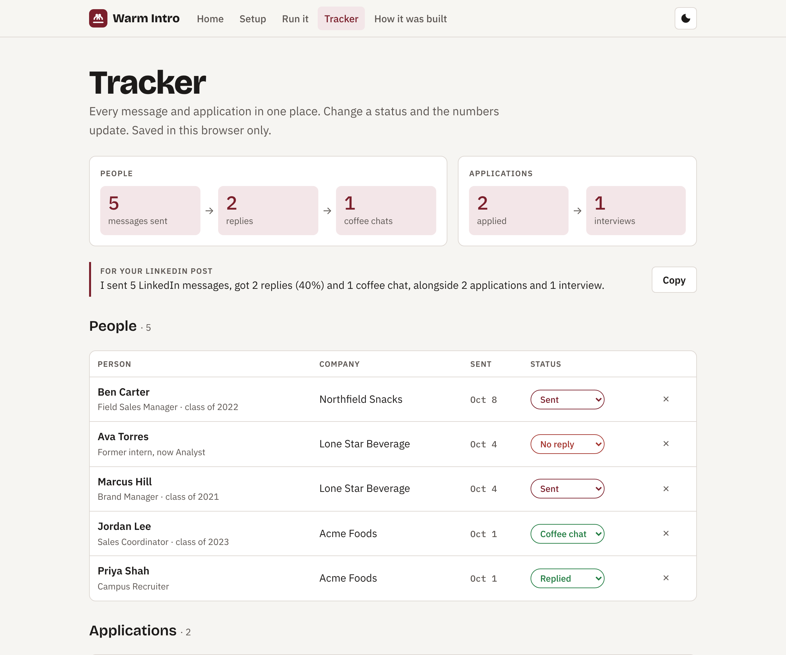

# Warm Intro

**AI internship outreach for students.** Warm Intro finds open internships, finds alumni from your school at those companies, drafts short LinkedIn messages you send yourself, and tracks every reply in one place.

**Live app:** https://blemons445.github.io/Warm-Intro-Linkedin-Outreach-Alumni-Network/



## Why

Referrals are only 6 to 7% of job applications but 30 to 50% of hires ([Chanty](https://www.chanty.com/blog/employee-referral-statistics/), citing Zippia, SHRM and Forbes Agency Council). Most students know they should network, but not who to message or what to say. Warm Intro does the research and leaves the conversations to you.

## What it does

| Step | What happens |
|------|--------------|
| 1. Set your target | Claude asks about ten short questions: cities, role, term, companies, school and year. |
| 2. Find open internships | Every posting is checked on the company's own careers site, with the best match flagged. |
| 3. Find alumni and recruiters | People you already know first, then alumni from your school, each confirmed from their education history. Recent graduates first. |
| 4. Draft first messages | A connection note under LinkedIn's 200-character limit, with one easy question. No referral asks. |
| 5. Tailor your resume | Rewritten to match the posting using only what's true, as a one-page PDF. |
| Tracker | Every message and application with its status, plus totals for a LinkedIn post. |
| Chat prep | When someone replies: their background, your 20-second intro and questions to ask. |

You send every message and every application yourself. The tool never sends, applies or connects for you.

## How to use it

1. Open the [live app](https://blemons445.github.io/Warm-Intro-Linkedin-Outreach-Alumni-Network/) and follow **Setup**: a free Claude account, and optionally a free [Clay](https://app.clay.com/signup) account connected to Claude.
2. On **Run it**, copy the skill into a new Claude chat and say "Help me find an internship."
3. Log each message and application in the **Tracker**.

No install, no account on this site. The tracker is stored in your own browser; use **Back up** to save a copy.

## How it was built

Warm Intro is two parts:

- **The skill** ([`skill/SKILL.md`](skill/SKILL.md)): the instructions Claude follows. It uses Clay to find people and web search to check postings.
- **The web app** (`index.html`, `assets/`): a plain HTML, CSS and JavaScript site with no build step, hosted on GitHub Pages. It guides setup, hands the skill to Claude and runs the tracker.

### Decisions that came from testing

I built this during my own Summer 2027 internship search, and most rules came from something that went wrong:

- **Postings are checked on the company's own site.** Job boards keep closed and last-year listings up.
- **Companies are identified by LinkedIn URL, not web domain.** Searching by domain matched the wrong companies (pga.org returned a small fund in Florida).
- **Every alumnus is confirmed one by one.** The search tool's school filter matched loosely, and similar names (Texas A&M-Commerce) don't count. About 1 in 9 current staff at a target company turned out to be alumni.
- **First messages ask a question, not for a call or referral.** People reply to something they can answer in a line.
- **Apply first, then message the same day.** Programs review applications as they arrive.
- **Tools are described honestly.** Apollo was tested as a second people source; its people search needs a paid plan, so the setup says so.

See the [changelog](CHANGELOG.md) for the full history.

### Results so far

On my own search: 10 open Dallas-Fort Worth internships found and verified, 3 applications, 6 LinkedIn messages and 1 reply.

## Run it locally

```sh
python3 -m http.server 8000
# open http://localhost:8000
```

## Credits

Adapted from [Use AI to Meet People at Companies You Want to Work For](https://vault.angussewell.com/resources/88) by Angus the Nontechnical.

Built by Bruce Hinson, Texas A&M. MIT License.
